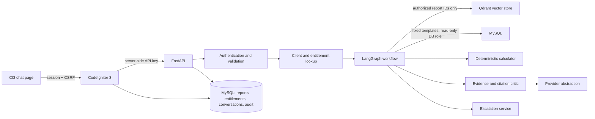
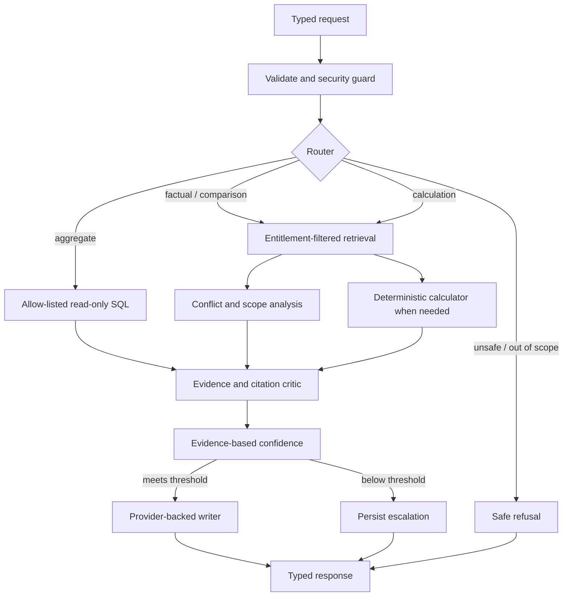

# Project Atlas Architecture

## Goals and source of requirements

Project Atlas adds a report copilot to a legacy CodeIgniter 3 portal. The user-pasted brief is the implementation request. The attached assignment PDF is the governing assessment source. The PDF emphasizes a correct, safe 2-3 day core and explicitly accepts cuts; the pasted brief expands the expected engineering detail. Where they differ, use the stricter shared requirement and document any scope cut honestly.

The data, clients, reports, and figures are fictional. The two smart-water market-size figures are intentionally different because their scopes differ. They must remain verbatim and must never be averaged.

## System overview

## Services and ownership

- **CodeIgniter 3 / PHP 8:** existing-portal integration, authenticated client context, CSRF-protected form posts, HTML escaping, conversation display and feedback. It calls FastAPI from the server; browser code never receives the AI service key.
- **FastAPI / Python 3.11+:** typed API contracts, request IDs, authentication, validation, orchestration, error mapping, and observability.
- **LangGraph:** explicit, inspectable state transitions for guards, routing, retrieval/tools, evidence checks, confidence, answer or escalation. Deterministic rules handle security and arithmetic; an LLM is only used for language generation/classification where enabled.
- **MySQL:** authoritative reports, clients, normalized entitlements, market metrics, conversation history, feedback, escalation tickets, request/cost records, and security events. Migrations/init SQL are repeatable for a fresh Compose deployment.
- **Qdrant:** chunk embeddings and report/page metadata. Retrieval receives an allow-list of entitled report IDs before vector search. Metadata is checked again before evidence is passed to the model.
- **LLM adapter:** provider selection through environment configuration (Groq, OpenAI, Gemini, or Ollama). Groq uses the official OpenAI-compatible chat completions endpoint with the existing `langchain-openai` integration. Missing credentials and provider/model failures return safe, categorized API errors; only evidence/confidence failures trigger analyst escalation.

## Request lifecycle and security boundaries

1. CI3 derives the client identity from the server-side session; the posted client ID is not trusted as authorization.
2. CI3 validates/escapes input and calls FastAPI with the private API key. FastAPI validates request size/schema and returns a request ID.
3. FastAPI authenticates the service request, resolves the client, and loads entitled report IDs from the normalized join table.
4. The graph applies unsafe/out-of-scope checks. An explicit report request can produce a report-exists/upgrade response, but cannot fetch its text.
5. The retriever filters the vector query by entitled report IDs. Post-filter assertions reject any chunk outside the allow-list; only then can evidence go to the LLM.
6. Injection-like content in retrieved chunks is treated as untrusted data, flagged and logged with sanitized IDs/metadata. The content is not followed as instruction. Legitimate evidence in the same report remains usable if it passes the normal evidence checks.
7. The graph selects factual, comparison, calculation, aggregate, unsafe, or out-of-scope handling. Aggregate SQL uses a small set of parameterized, application-owned read-only query templates. Natural-language requests never become SQL.
8. The critic checks every numeric statement against evidence/citation or a recorded calculation. Conflicts remain explicit. Confidence is computed from retrieval/evidence properties rather than accepted from model self-report.
9. Low confidence, missing evidence, unsupported forecast periods, or unresolved ambiguity create an escalation ticket. Successful turns and feedback are persisted.
10. The API logs duration, route, usage/cost when supplied by the provider, cache status, and escalation without recording secrets or unnecessary client data.

## Entitlement invariant

The non-negotiable invariant is: **no unauthorized report chunk is fetched into application evidence or sent to a model**. Entitlement lookup precedes vector search; `report_id in entitled_report_ids` is both a vector filter and a post-retrieval assertion. Tests will use a spy model/retriever boundary to verify unauthorized document text never crosses it. Cache keys, if implemented, include client identity and the sorted entitlement set (or its version) as well as the normalized question.

Seed purchases: C-01 purchased R-101 and R-103; C-02 purchased R-103. The Appendix A test additionally requires C-01 to compare R-101 with the R-102 public excerpt, while the test explicitly denies R-102 figures to C-02. To satisfy both statements without treating the excerpt as a purchase, the seed entitlement table grants C-01 an explicit R-102 excerpt entitlement; C-02 receives no such grant. This is an assessment access grant, not a claim that C-01 purchased R-102.

## Retrieval and evidence

Reports are source Markdown with explicit page/section boundaries. Ingestion extracts report metadata, chunks by section with bounded overlap, creates real embeddings, and upserts deterministic IDs to Qdrant. Each chunk carries report ID/title, publisher, sector, region, year, page, and access level. A deterministic local embedding backend may be used for offline reproducibility only if it is an actual embedding implementation and disclosed; it must not fabricate retrieval results. Production configuration should use sentence-transformers or another real embedding model.

R-101 page 8 preserves the exact supplied statement and values. R-102 page 14 preserves the exact injection trap and legitimate report data; its text is never interpreted as instructions. The other required reports are synthetic and clearly identified as such.

## Agent workflow

## Conflict and derived values

- R-101's 2024 USD 4.21B includes hardware, software, and services; R-102's USD 3.87B covers AMR/AMI hardware only. State both with scopes and citations; do not average or imply direct equivalence.
- CAGR calculations use `future = base × (1 + rate)^years`. A forecast starting in 2025 does not establish that a 2024 base figure is the correct base. Any APAC 2030 estimate therefore states the assumed base (e.g., APAC share applied to 2024 global value, then a 2025-2030 growth interval) and calls it a derived estimate. Do not silently extrapolate beyond 2030.
- Output separates quoted evidence from derived values and includes formula, inputs, units, period, assumptions, and citations.

## SQL safety

Only application-authored parameterized query templates are exposed. A separate MySQL read-only role is used for aggregate queries; the code rejects non-SELECT statements, applies row limits and timeouts, and never accepts model-generated SQL. The query template/parameters are surfaced for transparency. Write operations for conversations, feedback, tickets, and logs use the application role, not the aggregate tool.

## Confidence and escalation

Confidence is a transparent score from retrieval relevance, number/independence of supporting sources, numeric citation coverage, scope ambiguity, conflict, calculation certainty, and router certainty. Conflicts can lower confidence without suppressing a useful side-by-side answer. Unsupported numbers are removed or cause abstention. A configurable threshold creates a MySQL escalation with reason, client, conversation, question, and score.

## CI3, Docker, and operational trade-offs

Compose runs PHP/CI3, FastAPI, MySQL, and Qdrant with health checks and persistent data. MySQL initialization seeds the fictional assignment data. LLM and embedding model downloads or external API credentials may require network access at first start; this limitation must be explicit in setup docs. Typical latency depends on model/provider and hardware; the system records latency and should enforce a request timeout and token cap.

The implementation prioritizes access control, traceable evidence, correct conflict handling, and reproducible startup. Semantic reranking, production-grade identity/analyst dashboard, extensive PDF chart OCR, and cloud deployment are secondary and will be marked as cuts if not delivered.
