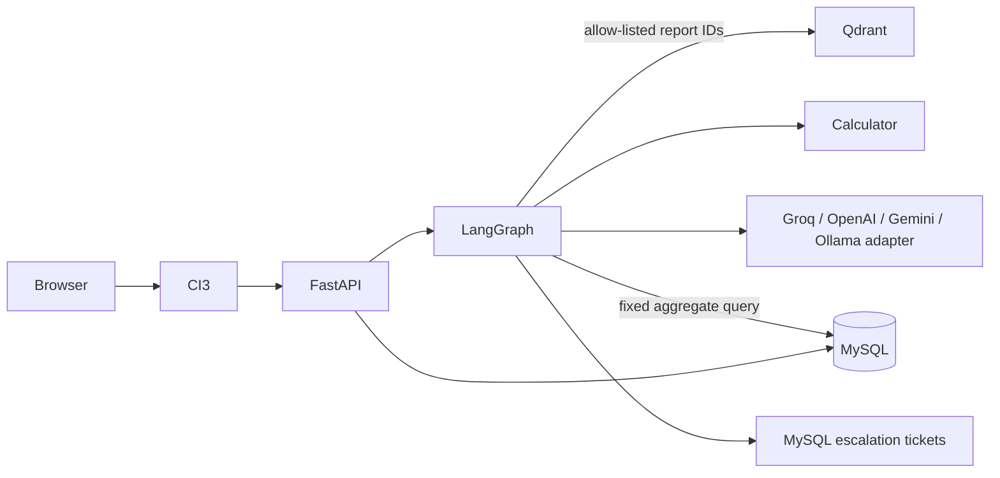

# Project Atlas — Report Copilot

Project Atlas is a fictional market-research copilot integrated with a CodeIgniter 3 portal. It provides an API-backed report assistant with entitlement-filtered RAG, explicit source citations, scoped conflict handling, deterministic derived calculations, aggregate queries, and analyst escalation.

## Requirements and status

The workspace started empty. Architecture choices are in [ARCHITECTURE.md](ARCHITECTURE.md); phase gates and the PDF/brief reconciliation are in [IMPLEMENTATION_PLAN.md](IMPLEMENTATION_PLAN.md). The assignment PDF's ten sample questions are included in a 25-case live evaluation set. The PDF asks for at least four additional reports beyond its three required reports; this corpus contains seven.

All corpus material other than the exact fictional seed values and trap text is synthetic. R-101 and R-102 differ by scope and must not be averaged. C-01's excerpt access to R-102 is a separate explicit evaluation grant; the purchase seed remains R-101 and R-103. C-02 is not granted R-101 or R-102 access.

## Architecture



## Quick start

Prerequisites: Docker Engine with Compose plugin and an LLM provider key for open-ended generated answers. Windows/macOS users can run Docker Desktop.

```sh
cp .env.example .env
# Set API_KEY to a long random value and set LLM_PROVIDER / provider key.
docker compose up --build
```

The portal is at `http://localhost:8080/copilot`; the API docs are at `http://localhost:8000/docs`. First startup downloads Python dependencies and the sentence-transformer model, so network availability is required. The API idempotently ingests the bundled corpus before serving requests. The included source corpus is Markdown under `ai-service/data/reports`.

For local Ollama instead of a hosted provider, set `LLM_PROVIDER=ollama` and `MODEL_NAME` in `.env`, then run `docker compose --profile local-llm up --build` and pull the selected model with `docker compose exec ollama ollama pull llama3.1` (replace the model to match `MODEL_NAME`). The model download is large and is not part of the default quick start.

To re-ingest a corpus report manually (deterministic IDs make re-ingestion idempotent):

```sh
for id in R-101 R-102 R-103 R-104 R-105 R-106 R-107; do
  curl -fsS -X POST http://localhost:8000/ingest \
    -H "X-API-Key: $(grep '^API_KEY=' .env | cut -d= -f2-)" \
    -H 'Content-Type: application/json' -d "{\"report_id\":\"$id\"}"
done
```

The demo portal offers a C-01/C-02 selector. This is explicitly a local assessment simulation, not production authentication. A real deployment must source the client ID from the existing portal's authenticated server session.

## Configuration

Copy `.env.example` to `.env`. Create a Groq key in the [Groq Console API keys page](https://console.groq.com/keys), then set `LLM_PROVIDER=groq`, `GROQ_API_KEY`, and `MODEL_NAME=openai/gpt-oss-120b`. Groq is called through its OpenAI-compatible chat completions endpoint using the existing `langchain-openai` integration; `OPENAI_API_KEY` remains available for the OpenAI provider. Other accepted values are `openai`, `gemini`, and `ollama`, with the matching provider key where required. Set `API_KEY`, `DATABASE_URL`, `READONLY_DATABASE_URL`, `VECTOR_DB_URL`, `EMBEDDING_MODEL`, and `CONFIDENCE_THRESHOLD` for deployment. To record an estimated USD cost, set `LLM_INPUT_COST_PER_1K` and `LLM_OUTPUT_COST_PER_1K` to the rates for the configured provider/model; rates are not hard-coded. Without those rates, token counts are logged and estimated cost remains null. Do not commit `.env` or real credentials. Compose uses development-only MySQL credentials; rotate them before any non-local use.

## API

- `GET /health` — MySQL and Qdrant readiness indicator.
- `POST /chat` — typed request with `client_id`, `message`, optional `conversation_id`; requires `X-API-Key`.
- `POST /ingest` — idempotently ingest one source Markdown report; requires `X-API-Key`.
- `GET /escalations` — open escalation list for analyst/demo use; requires `X-API-Key`.

Example:

```sh
curl -X POST http://localhost:8000/chat \
  -H 'X-API-Key: replace-with-a-long-random-secret' -H 'Content-Type: application/json' \
  -d '{"client_id":"C-01","message":"What was the global smart water meter market size in 2024?"}'
```

## Security and design decisions

Entitlements are normalized in `client_report_entitlements`. The server resolves allowed report IDs before vector search, filters at Qdrant, and asserts the allow-list again before passing passages to the writer. Unsafe requests are stopped before graph/tool execution. Aggregate questions use one fixed read-only SQL query, never model-authored SQL. R-102's trap text is document data; it is flagged as a sanitized security event. The writer uses an explicit untrusted-evidence boundary. CI3 escapes rendered fields and enables CSRF; its API key remains server-side.

Comparison and CAGR-derived responses use deterministic code and the supplied seed figures. Generic prose uses configured Groq, OpenAI, Gemini, or Ollama through the provider adapter. Provider configuration and service errors return safe HTTP errors; they are not converted into low-confidence analyst escalations. Evidence-based confidence failures still create analyst escalations.

## Tests and evaluation

Run `python -m pytest ai-service/tests` from the repository root after installing `ai-service/requirements.txt`. Run the live harness with `python ai-service/evaluation/runner.py` while Compose is running and `API_KEY` is exported. See [EVALUATION.md](EVALUATION.md) for measurement definitions and current run status. Results are not claimed until those commands have actually been run.

## Known limitations / scope cuts

- Generated report prose now passes a claim review before return. The review splits sentences, semicolon clauses, line-separated claims, and common coordinated clauses; requires each clause to cite a page in the retrieved evidence; checks page validity and numeric support deterministically; and catches common emphasis upgrades (such as “discusses” to “focuses on”) and causal wording. Coordinated predicate forms that the deterministic splitter cannot safely separate are rejected for analyst review. A constrained JSON entailment verdict then checks each remaining claim against its cited passages and must reject a multi-assertion claim if any component is unsupported. Other retrieved passages from the same report are supplied only to flag contradictions. Invalid citations, rejected claims, malformed review output, and verifier provider failures withhold the draft and use analyst escalation. This is a conservative review gate, not proof of factual accuracy; complex paraphrases, subtle contradictions, and model judgments can still be wrong.
- Displayed confidence remains the existing retrieval relevance, evidence page coverage, citation coverage, router certainty, and calculation score. It is not a probability that each generated claim is factually correct. A claim review pass does not change that scoring meaning.

- This checkout has no prior CI3 portal; the provided CI3 shell is an integration scaffold with demo-only client selection.
- No semantic response cache is enabled. This avoids cross-client cache leakage; repeated-question latency optimization remains future work.
- The evaluator currently checks response safety, citation overlap, confidence, escalation, and latency, but does not prove full semantic correctness. Human review is still needed.
- The numeric critic is deliberately conservative and checks textual numeric support; it is not a general entailment model.
- MySQL, Qdrant, and the CI3 portal are real configured services. Live provider responses require a valid provider credential; provider errors are surfaced separately from evidence-confidence escalations.
- Sentence-transformer model download and provider credentials are required for RAG/model generation. No external results are mocked.
- Request latency is logged. Provider token usage and estimated cost columns exist in the schema but are not populated yet; cost observability remains incomplete.

## AI-assisted development disclosure

An AI coding assistant was used to draft the architecture, implementation plan, code, synthetic report corpus, tests, and documentation. The assessment owner should review and understand every file before submission and disclose the tool use as requested by the assignment.
